  

  
  
  
  

## 👋 &nbsp;About me

I build web platforms where **AI does the actual work**, not something bolted on as a feature. I work end to end, from API design and databases to the interface and the deployment pipeline around it.

> The hard part usually isn't the model. It's everything around it: making it fast enough to feel interactive, structured enough to trust, and simple enough that anyone can use it.

<table>
  <tr>
    <td width="50%" valign="top">
      💼 &nbsp;NOW 
      <b>Software Engineer Intern</b> 
      <a href="https://kayaintelligence.com/">Kaya</a> · Apr 2026 to present
    </td>
    <td width="50%" valign="top">
      🎓 &nbsp;STUDYING 
      <b>BSc (Hons) Computer Science</b> 
      University of Westminster (IIT)
    </td>
  </tr>
  <tr>
    <td width="50%" valign="top">
      📜 &nbsp;CERTIFIED 
      <b>Azure AI Apps and Agents Developer</b> 
      <a href="https://learn.microsoft.com/api/credentials/share/en-us/OshadhaVimukthi/8594C25086026021?sharingId=2467F1F91060F094">Microsoft Associate · AI-103</a>
    </td>
    <td width="50%" valign="top">
      🟢 &nbsp;OPEN TO 
      <b>Graduate roles and internships</b> 
      <a href="mailto:oshadhavjb@gmail.com">oshadhavjb@gmail.com</a>
    </td>
  </tr>
</table>

## 🧰 &nbsp;Stack

<table>
  <tr>
    <td width="110"><b>FRONTEND</b></td>
    <td></td>
  </tr>
  <tr>
    <td><b>BACKEND</b></td>
    <td></td>
  </tr>
  <tr>
    <td><b>AI</b></td>
    <td>
      
      
      
      
    </td>
  </tr>
  <tr>
    <td><b>TOOLS</b></td>
    <td></td>
  </tr>
</table>

  Building where AI does the real work · <a href="https://oshadha.com">oshadha.com</a>

